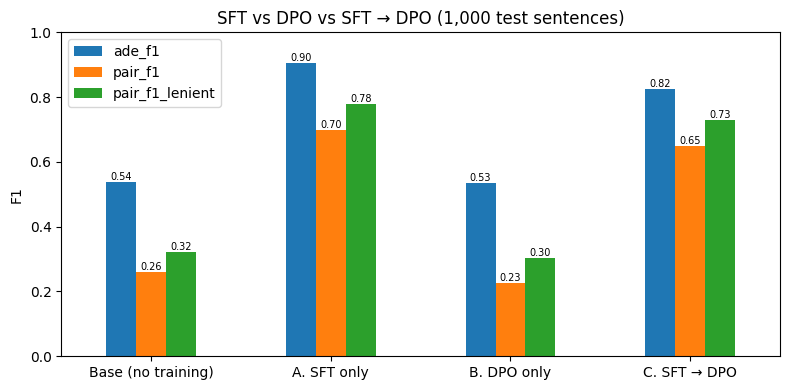

# Fine-tuning Qwen2.5-1.5B for adverse drug event extraction

## Objective
Fine-tune an open LLM (at least 1B parameters) to read a sentence from a medical case report and:
1. decide whether it describes an adverse drug event (ADE), and
2. extract every (drug, effect) pair,

returning valid JSON:
```json
{"has_ade": true, "pairs": [{"drug": "azithromycin", "effect": "ototoxicity"}]}
```
Success = clear improvement over the base model on unseen test sentences.

## Data
- Dataset: `ade-benchmark-corpus/ade_corpus_v2` (Hugging Face), classification and drug-ADE relation configs.
- The raw data repeats ADE sentences once per drug-effect pair (6,821 rows, 4,271 unique sentences). I merged the two configs into **one record per unique sentence** (20,896 sentences) with a list of pairs.
- After de-duplication the real ADE share is **20%** (not 29% as the raw rows suggest).
- Split by unique sentence, stratified by label (`random_state=42`): **train 19,396 / validation 500 / test 1,000**, 20.4% ADE in each, zero overlap between splits.

## Method
- Base model: **Qwen2.5-1.5B-Instruct** (1.54B parameters, Apache-2.0).
- **QLoRA**: base weights frozen in 4-bit NF4; LoRA adapters (r=16, alpha=32, dropout 0.05) on attention and MLP projections. **18.5M trainable parameters (1.18%)**.
- Chat-format prompt (system rules + sentence) and JSON answer; loss computed on the answer only.
- 1 epoch, effective batch 16, learning rate 2e-4 (cosine, warmup), max length 768. Free Kaggle T4, ~54 min.
- Validation loss fell at every checkpoint (0.029 → 0.019), no overfitting.

## Results (1,000 held-out test sentences)
Base and fine-tuned models get the identical prompt and greedy decoding; the base model is the same model with the adapter disabled.

| Metric | Base | Fine-tuned |
|---|---|---|
| Valid JSON | 99.7% | **100%** |
| ADE precision | 0.40 | **0.93** |
| ADE recall | 0.82 | **0.88** |
| **ADE F1** | 0.54 | **0.90** |
| Pair precision | 0.18 | **0.70** |
| Pair recall | 0.49 | **0.69** |
| **Pair F1 (strict exact match)** | 0.26 | **0.70** |
| Pair F1 (lenient, overlapping effect span) | – | 0.78 |

The base model flags most medical sentences as ADEs (precision 0.40). Fine-tuning removes most false alarms while also improving recall.

## Error analysis (fine-tuned model)
- **False alarms (13):** drug and condition mentioned together without a causal claim: associations ("seen with", "risk of"), multi-factor causes, and indications (drug given *to treat* the condition).
- **Misses (25):** abbreviations (aspirin → "RS", "HDARAC"), poisoning/intoxication cases (methanol, colchicine), hedged wording ("may be a risk factor").
- **Label inconsistency:** similar wording is labelled ADE in some sentences and not in others (e.g. time-to-onset statements), which limits achievable precision and recall.
- **Extraction:** many strict "errors" are span-boundary differences ("hepatic necrosis" vs "overwhelming hepatic necrosis"); the dataset has no consistent rule for severity or location words. Lenient pair F1 is 0.78 vs 0.70 strict.

## Limitations and next steps
- Single run, single split; no hyperparameter search.
- Next: contrastive examples (indication vs ADE, association vs causation), abbreviation expansion, comparing r=8/16/32, and a few-shot prompting baseline.

## Follow-up: SFT vs DPO vs SFT → DPO
**Question:** is SFT alone better, DPO alone better, or the combination (SFT followed by DPO)?
Notebook: `ade_sft_vs_dpo.ipynb`. Same data, split, prompt, 1,000 test sentences, greedy decoding and metrics as above; all four setups evaluated in the same session.

| Setup | Starts from | Trained with | Reference model |
|---|---|---|---|
| A. SFT only | base | SFT on 19.4k examples (the adapter above) | – |
| B. DPO only | base | DPO, new LoRA (same shape as above) | base (adapter off) |
| C. SFT → DPO | SFT adapter | DPO, continuing the SFT adapter | frozen copy of the SFT adapter |

- **Preference pairs:** 2,500 training sentences (1,250 ADE + 1,250 non-ADE) for training, the 500 validation sentences for validation. Chosen = gold JSON. Rejected = the starting model's own wrong answer, or a rule-based corruption of the gold answer when the model was right (false alarm, missed ADE, dropped pair, swapped drug/effect, shortened effect span). Real model mistakes: 1,289/2,500 for B, 375/2,500 for C.
- **DPO:** TRL `DPOTrainer`, β = 0.1, learning rate 2e-5, 1 epoch (157 steps), effective batch 16, about 29 min per setup on a T4.



| Metric | Base | A. SFT | B. DPO only | C. SFT → DPO |
|---|---|---|---|---|
| Valid JSON | 99.7% | **100%** | 27.7% | 99.5% |
| ADE precision / recall | 0.40 / 0.82 | **0.93** / 0.88 | 0.47 / 0.62 | 0.72 / **0.96** |
| **ADE F1** | 0.54 | **0.90** | 0.53 | 0.83 |
| Pair precision / recall | 0.18 / 0.49 | **0.70** / 0.69 | 0.17 / 0.34 | 0.56 / **0.78** |
| **Pair F1** (strict / lenient) | 0.26 / 0.32 | **0.70 / 0.78** | 0.23 / 0.30 | 0.65 / 0.73 |
| False alarms / misses | 252 / 36 | **13** / 25 | 145 / 77 | 75 / **8** |

**Findings**
1. **SFT alone is best** on ADE F1 and pair F1, with 100% valid JSON.
2. **DPO alone did not learn the output format** (27.7% valid JSON). Its training separated chosen from rejected perfectly (reward accuracy 1.0), but the correct answers became much less likely than in the base model (Rewards/chosen −4.46).
3. **SFT → DPO kept the format but shifted towards recall:** misses 25 → 8, false alarms 13 → 75, and extra drug–effect pairs (pair recall up, precision down). Compared with SFT, it fixed 23 test sentences and broke 70.

**Judgement:** for this extraction task SFT alone is the best choice. DPO alone is not suitable, and adding DPO after SFT lowered F1 by trading precision for recall.

**Limitations and next steps:** one run per setup; DPO settings (β, learning rate) not tuned; 85% of C's rejected answers were synthetic corruptions; the preference sample was 50/50 ADE vs 20% in the data. These are possible factors for C's shift, not yet tested; the next step is to change them one at a time (only real mistakes, the natural class ratio, a lower learning rate or higher β).

## Model and reproduction
- Adapter: [AadarshKr/qwen2.5-1.5b-ade-lora](https://huggingface.co/AadarshKr/qwen2.5-1.5b-ade-lora) (also contains `eval_results.json`).
- Notebook: `ade_llm_finetune.ipynb` (Kaggle, GPU T4). Run the install cell, restart, then run cells in order.
- Follow-up notebook: `ade_sft_vs_dpo.ipynb` (Kaggle, GPU T4, about 2.5 h; set `TEST_MODE = True` for a quick dry run). DPO adapters and results: [AadarshKr/qwen2.5-1.5b-ade-dpo](https://huggingface.co/AadarshKr/qwen2.5-1.5b-ade-dpo).
- Kaggle setup: add your Hugging Face token as a Kaggle secret named `HF_TOKEN` (needed to push and download the adapter and results).
- Training and the full evaluation were run once. The saved notebook re-runs the data, model-loading and analysis cells; the training log and evaluation results are recorded in the notebook and `eval_results.json` is loaded from the Hugging Face repo.

```python
from peft import PeftModel
from transformers import AutoModelForCausalLM, AutoTokenizer
base = AutoModelForCausalLM.from_pretrained("Qwen/Qwen2.5-1.5B-Instruct")
model = PeftModel.from_pretrained(base, "AadarshKr/qwen2.5-1.5b-ade-lora")
tokenizer = AutoTokenizer.from_pretrained("AadarshKr/qwen2.5-1.5b-ade-lora")
```

## References
- Hu et al., 2021. *LoRA: Low-Rank Adaptation of Large Language Models.* https://arxiv.org/abs/2106.09685
- Dettmers et al., 2023. *QLoRA: Efficient Finetuning of Quantized LLMs.* https://arxiv.org/abs/2305.14314
- ADE Corpus V2 dataset card: https://huggingface.co/datasets/ade-benchmark-corpus/ade_corpus_v2
- Qwen2.5-1.5B-Instruct model card: https://huggingface.co/Qwen/Qwen2.5-1.5B-Instruct
- Rafailov et al., 2023. *Direct Preference Optimization: Your Language Model is Secretly a Reward Model.* https://arxiv.org/abs/2305.18290
- Hugging Face TRL, `SFTTrainer`: https://huggingface.co/docs/trl/sft_trainer
- Hugging Face TRL, `DPOTrainer`: https://huggingface.co/docs/trl/dpo_trainer
- Hugging Face PEFT, LoRA: https://huggingface.co/docs/peft/main/en/conceptual_guides/lora
- Transformers, bitsandbytes quantization: https://huggingface.co/docs/transformers/main/en/quantization/bitsandbytes
- Transformers, chat templates: https://huggingface.co/docs/transformers/main/en/chat_templating
- Transformers, generation with LLMs: https://huggingface.co/docs/transformers/main/en/llm_tutorial
